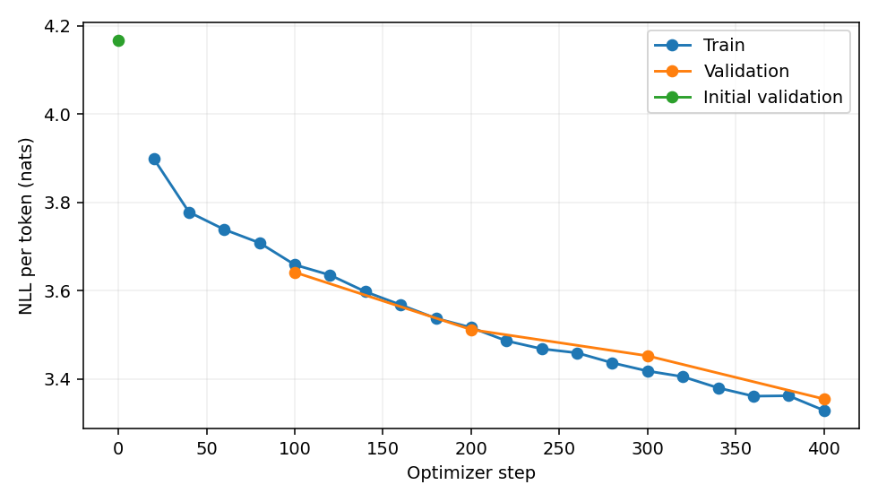
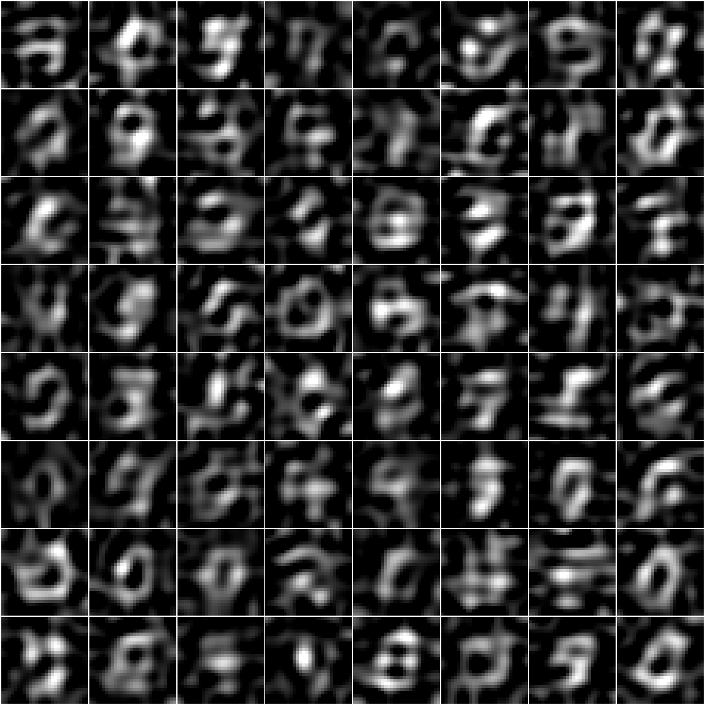
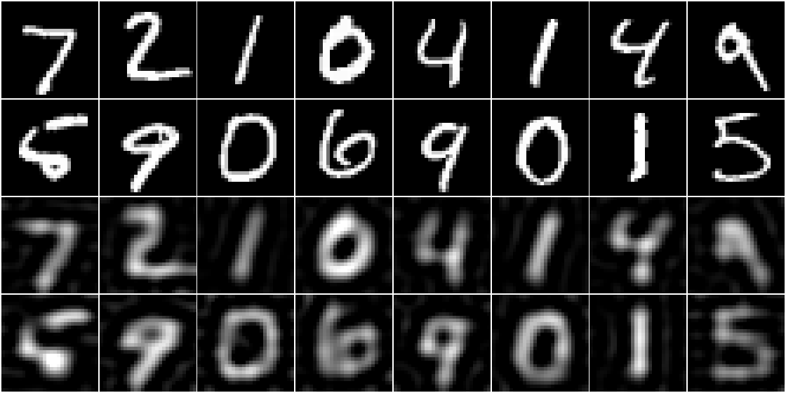

# Локальный MNIST DCT64 baseline

Эксперимент выполнен **20 октября 2026**, на Windows 11 / Intel i5-13500H, CPU, 4 потока. Весь цикл занял **58,40 с** после предварительного скачивания MNIST. Исходники: commit `07c1ac42afbfd576b78d3c81ea965a84dfeed3ba`, рабочее дерево перед запуском чистое.

Объединённый конвейер обучает модель, выбирает checkpoint по validation, генерирует изображения и считает метрики. Это небольшой проверочный бейзлайн: генерации ещё размыты, охват распределения низкий.

## Конфигурация

| Параметр | Значение |
| --- | --- |
| Данные | MNIST, 28×28, grayscale |
| Train / validation / test | 4 096 / 512 / 512 изображений |
| Разбиение | validation из официального train, seed 42; test независим |
| Представление | DCT → zigzag → первые 64 коэффициента → signed_log(scale=255) |
| Квантование | uniform, 64 bins, диапазоны на каждой позиции, fit только на train |
| Модель | causal Transformer, RoPE, 2 слоя, d_model=64, 4 головы, FF=128 |
| Параметры модели | 75 328 |
| Обучение | AdamW lr=0,001, weight_decay=0,01, batch=64, 400 шагов |
| Выбор checkpoint | минимальный validation NLL, выбран шаг 400 |
| Генерация | 256 изображений, temperature=0,8, без top_k, seed 43 |
| Энкодер метрик | CNN MNIST, 64 признака, 10 классов; 5 эпох на том же train, seed 44 |

Resolved-конфиг: [config.yaml](config.yaml). Версии пакетов, формы/количество изображений и SHA256 каждого split: [metadata.json](metadata.json). Полные численные результаты: [summary.json](summary.json).

## Результаты

| Оценка | Значение |
| --- | ---: |
| Validation NLL до обучения, nats/token | 4,16682 |
| Validation NLL после обучения | 3,35453 |
| Снижение validation NLL | 19,49% |
| Test NLL | 3,36901 |
| Test bits/token | 4,86046 |
| Test perplexity | 29,04988 |
| Test token accuracy | 8,743% |
| Fréchet в признаках MNIST CNN ↓ | 141,55011 |
| Classifier score генераций ↑ | 1,86860 |
| Classifier score реальных изображений | 6,08753 |
| kNN precision (k=3) ↑ | 0,80859 |
| kNN recall (k=3) ↑ | 0,07813 |
| Accuracy энкодера на validation | 87,50% |
| Accuracy энкодера на 256 real test изображениях | 90,625% |
| MSE восстановления токенизатора | 0,02431 |
| PSNR восстановления | 16,14171 dB |

NLL рассчитан на 512 test-изображениях. Метрики изображений и реконструкции — на 256 real и 256 fake. Test использован после выбора checkpoint; классификатор обучен на train и выбран по validation.

**Эти Fréchet и classifier score не являются стандартными FID и Inception Score**: здесь признаки и вероятности MNIST CNN. Формулы те же, но пространство признаков другое. Precision/recall тоже зависят от этого энкодера и небольшой выборки. Классификатор несовершенен, поэтому метрики служат диагностикой; высокий precision вместе с низким recall не означает хорошего качества и разнообразия. Bits/token относится к квантованным DCT-коэффициентам, а не pixel bpd.

### Обучение



Validation NLL снижается вместе с train NLL. По этому короткому запуску нельзя сделать вывод о предельном качестве модели или её поведении после длительного обучения.

### Сгенерированные изображения

Первые 64 из 256 сгенерированных примеров:



Встречаются формы, похожие на цифры, однако изображения размыты и содержат артефакты. При данном представлении отброшены 720 из 784 DCT-коэффициентов; это ограничивает чёткость даже при идеальной модели.

### Исходники и восстановление токенизатора

Верхние 2 строки — 16 реальных изображений, нижние 2 — те же изображения после encode/decode **без генерации моделью**:



Это позволяет отдельно увидеть потери от усечения и квантования. Генерации в предыдущем блоке добавляют к ним ошибку авторегрессионной модели.

## Воспроизведение

Из корня проекта, после настройки окружения:

```powershell
.venv/Scripts/python.exe run_experiment.py train --config configs/mnist_baseline.yaml --run-id reproduction
.venv/Scripts/python.exe run_experiment.py evaluate --run-dir runs/mnist_dct64_baseline/reproduction --device cpu
.venv/Scripts/tensorboard.exe --logdir runs
```

Оригинальный полный запуск остаётся локально в `runs/mnist_dct64_baseline/local-cpu-baseline/`: там находятся `best.pt`, `latest.pt`, `mnist_encoder.pt`, `generated.npz` и TensorBoard events. Тяжёлые checkpoint и данные исключены из Git. В этот каталог отчёта экспортированы конфиг, параметры токенизатора, метаданные, JSONL и изображения.

Повторная оценка оригинального запуска выполнена без обучения: все численные значения **точно совпали** с первоначальными на том же CPU. Результат сохранён в [evaluation.json](evaluation.json). Сквозной offline-тест также проверяет повторную оценку и отклоняет изменившиеся данные по SHA256.

Проверки проекта: **71 тест пройден**, `ruff check .` пройден, TensorBoard CLI успешно прочитал scalar events. Inception/CLIP подключены как дополнительные энкодеры; этот отчёт не содержит результатов их запуска. CIFAR10/CelebA/ImageNet здесь не обучались.

Для следующих экспериментов через конфиг можно увеличить число шагов/обучающих изображений, сравнить 64/128/784 коэффициента и варианты преобразований. Меняя токенизатор, сравнивайте реконструкции и генеративные метрики: NLL разных пространств токенов напрямую несопоставим.
